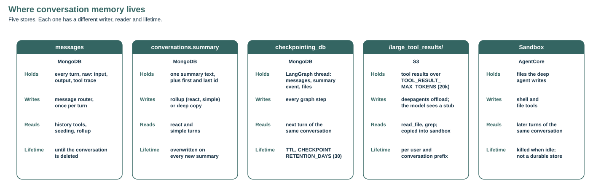
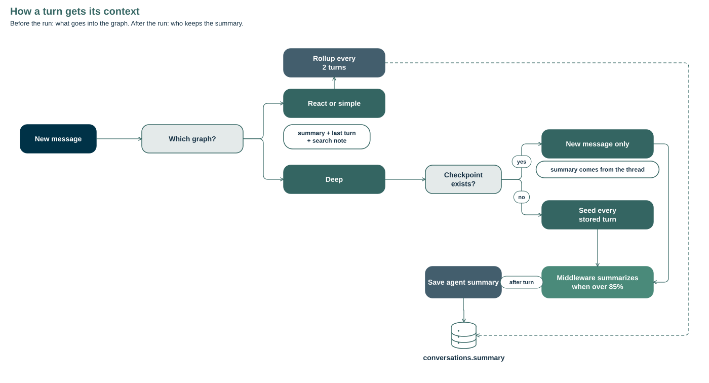
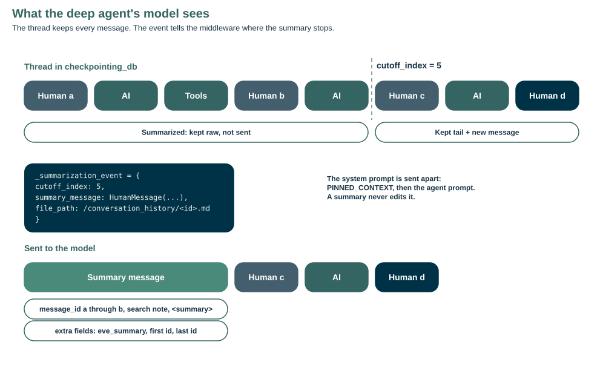
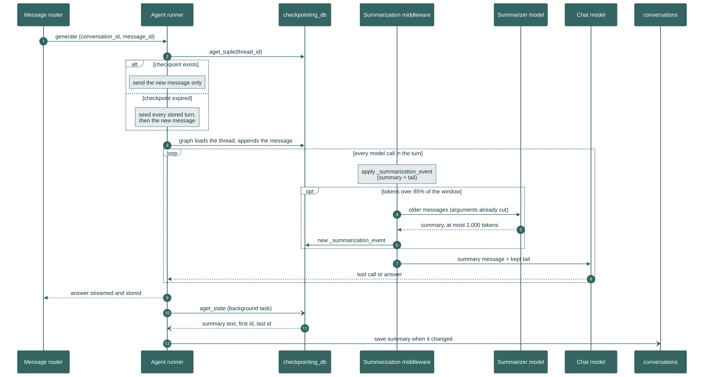

## Context management

A conversation is remembered in five places. Which ones a turn reads depends on the graph: `react`, `simple`, or `deep`. Only the deep graph summarizes on its own. The backend stores the summary it writes.

### Stores

| Store | Holds | Written by | Lifetime |
| --- | --- | --- | --- |
| `messages` | Every turn: input, output, tool trace | The message router, once per turn | Until the conversation is deleted |
| `conversations.summary` | One summary, plus `summary_first_message_id` and `summary_last_message_id` for a deep summary | The rollup, or the copy of the deep summary | Overwritten by the next summary |
| `checkpointing_db` | The LangGraph thread, `thread_id` = conversation id: messages, `_summarization_event`, `files` | Every graph step | `CHECKPOINT_RETENTION_DAYS` (30) |
| S3 `/large_tool_results/` | Tool results over `TOOL_RESULT_MAX_TOKENS` (20,000). The model sees a stub and a path | deepagents offload | Per user and conversation prefix |
| Sandbox | Files the deep agent writes | Shell and file tools | Until the idle reaper kills it. See [Sandbox](sandbox.md) |

`/conversation_history/` is routed to `StateBackend`, so that file is in the `files` channel of the checkpoint and expires with it.

### Context per graph

| Graph | Goes into the graph | After the turn |
| --- | --- | --- |
| `react`, `simple` | Rolling summary with the search note, and the last turn | `maybe_rollup_and_trim_history`, every 2 turns |
| `deep`, checkpoint exists | The new message only | `save_agent_summary` |
| `deep`, no checkpoint | Every stored turn, then the new message | `save_agent_summary` |

A deep turn does not read `conversations.summary`. When the thread exists, its summary is already in the checkpoint. When the thread has expired, `_seed_turns` rebuilds it from `messages`. Every human message carries `eve_message_id` in `additional_kwargs`, so a summary can name the messages it covers. `PINNED_CONTEXT` goes in front of the system prompt and the artifact rule (`/artifacts/{id}` links only) at its end. React and simple send that rule as a `SystemMessage` on the first turn instead. A summary never edits the system prompt.

### Deep summarization

`EveSummarizationMiddleware` in `eve-esa/agents` extends the deepagents `SummarizationMiddleware`. It runs before each model call, also between tool calls of one turn. Nothing runs in the background.

1. Count the tokens of the messages the model would receive.
2. Under the trigger, send them unchanged.
3. Over the trigger, cut long `write_file` and `edit_file` arguments in the older messages first. Then summarize the older messages with the same model, capped at `SUMMARY_MAX_TOKENS`. The cut never separates a tool call from its result.
4. Store the summary in `_summarization_event` with `cutoff_index`. The raw messages stay in the thread.
5. Send the summary message, then the messages from `cutoff_index` onward.

The summarization prompt is the `summary` key of `agents/graphs/deep/prompts.yaml` in `eve-esa/agents`. It asks for fixed sections (user goal, facts and values, answers given, sources and tool results, files, open questions), values copied verbatim, nothing beyond what the messages state, and every fact of an earlier summary carried forward. System messages in the older part are not sent to the summarizer. They leave the model's view at the cutoff, so a standing rule belongs in the system prompt or `PINNED_CONTEXT`, not in a `SystemMessage`.

The summary message states the covered range ("Summarized message_id A through B"), the search note, and the summary in `
` tags. Its `additional_kwargs` carry `eve_summary`, `eve_summary_first_message_id` and `eve_summary_last_message_id`. A later summary folds the earlier one in, so the range keeps the first start id. `search_history` and `read_history` read the raw messages behind the range. See [Queryable history](queryable-history.md).

| Setting | Default | Meaning |
| --- | --- | --- |
| `AGENT_CONTEXT_WINDOW_TOKENS` | `MODEL_CONTEXT_SIZE` (128,000) | Window the fractions apply to |
| `SUMMARY_TRIGGER_FRACTION` | 0.85 | Summarize, and cut old arguments, above this share of the window |
| `SUMMARY_KEEP_FRACTION` | 0.10 | Share of the window kept verbatim after a summary |
| `SUMMARY_MAX_TOKENS` | 2,000 | Output cap of the summary call |
| `TRUNCATE_ARGS_MAX_CHARS` | 2,000 | Arguments longer than this keep their first 20 characters |
| `PINNED_CONTEXT` | empty | Text placed in front of the deep agent's system prompt |

The runner passes each setting only when `DeepAgent.compile` declares it, so an older agents pin still compiles.

### A deep turn

Source: `assets/memory/deep-turn.mmd`.

The summary call is not streamed to the client. `stream_mode="messages"` yields its chunks from the `model` node like answer tokens, tagged `lc_source: summarization` and `lc_internal_call`. The runner drops them.

After the answer is stored, `save_agent_summary` reads the thread state with `graph.aget_state`. When the event carries `eve_summary` and it differs from the stored copy, it writes the text and the two ids to the conversation. The streamed path runs it as a background task. The non-streamed path starts it with `asyncio.create_task`, and the router skips the rollup when `prompts.agent_graph_type` is `deep`.

### Checking it

Run the local stack with `AGENT_CONTEXT_WINDOW_TOKENS=8000` and send a few long deep turns in one conversation. The checkpoint gains `_summarization_event`. The conversation document gains `summary`, `summary_first_message_id` and `summary_last_message_id`, and they change only when the agent summarizes again. Ask for a detail from the first turn: the trace should show `search_history` or `read_history`. The streamed answer must not contain the summary text. A `react` conversation keeps updating its summary every 2 turns.
