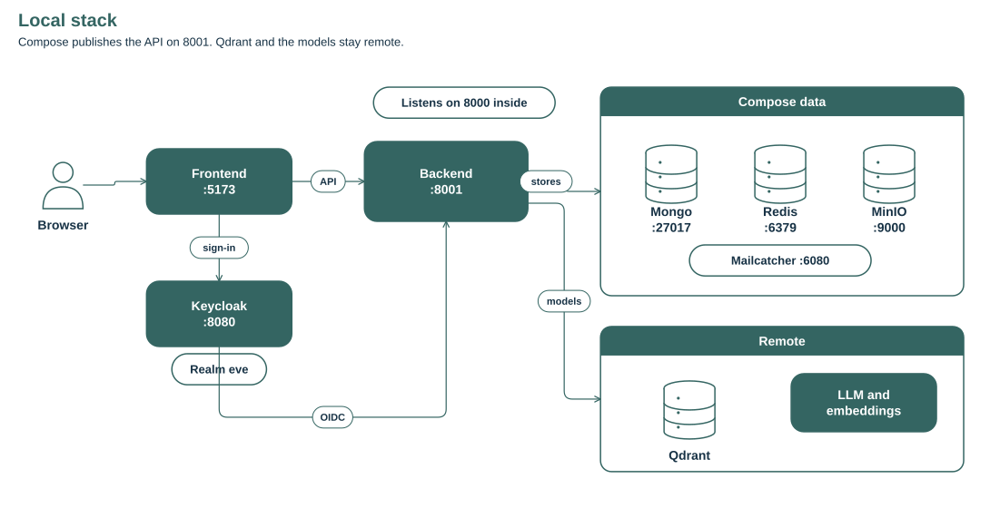
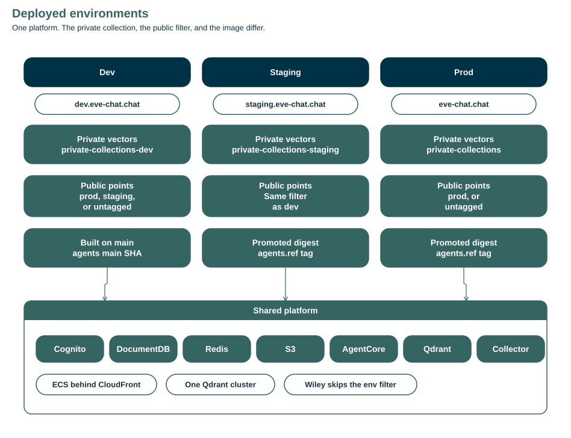

## Environments

Four places run this API. Local is Docker Compose, or a process started on the host. Dev, staging, and prod are the same service on ECS, behind CloudFront, with the API under `/api`.

### Local

Compose publishes the API on port **8001**. The process inside the container listens on **8000**. [Local development](local_setup.md) starts the API on the host at `http://localhost:8000`. [Docker setup](docker_setup.md) uses the published port, `http://localhost:8001`.

The compose `frontend` service sets `VITE_API_URL=http://localhost:8000`. That is the port inside the backend container, not the port the browser can open. A frontend on the host should call `http://localhost:8001` when the API is the compose backend.

Keycloak is the local identity provider, realm `eve`, client `eve-frontend`. Deployed environments use Cognito. The API sees an issuer, an audience, and a JWT. See [Identity provider architecture](adr/identity-provider-architecture.md).

MongoDB, Redis, MinIO, and Mailcatcher start with compose. Qdrant and the model endpoints stay on the URLs in `.env`. The sample env sets `APP_ENVIRONMENT=dev`, so a local process that reaches the shared Qdrant uses `private-collections-dev` and the non-production public filter below.

Compose does not start `eve_retrieval`. Document search in an agent turn calls that MCP server, and the `mcp_servers` row still points at the deployed runtime until it is changed.

### Dev, staging, and prod

| | Dev | Staging | Prod |
| --- | --- | --- | --- |
| Host | `dev.eve-chat.chat` | `staging.eve-chat.chat` | `eve-chat.chat` |
| API | `/api` | `/api` | `/api` |
| `APP_ENVIRONMENT` | `dev` | `staging` | `prod` |
| Private collection | `private-collections-dev` | `private-collections-staging` | `private-collections` |
| Public points | `env` is `prod` or `staging`, or the point has no `env` | same as dev | `env` is `prod`, or the point has no `env` |
| Image | built on push to `main` | promoted by digest, not rebuilt | promoted by digest, not rebuilt |
| Agents pin | `agents` `main` SHA | `agents.ref` tag, baked into that image | the same kind of release image |

Wiley collections are not filtered by `env`. An unknown `APP_ENVIRONMENT` is treated as non-production and uses the dev private collection. `PRIVATE_COLLECTION_NAME` overrides the derived name.

`APP_GIT_SHA` is baked when the image is built. `APP_VERSION` is set when the task is deployed. Staging and prod receive the image by digest and do not rebuild it.

Identity on AWS is one Cognito pool per environment. The datastore is DocumentDB. Objects are in S3. The conversation sandbox is AgentCore. Telemetry stays off until `OTEL_EXPORTER_OTLP_ENDPOINT` is set. `service.name` is `eve-backend`. `deployment.environment.name` is what separates dev, staging, and prod in the traces. The variables are in [Local development](local_setup.md).
