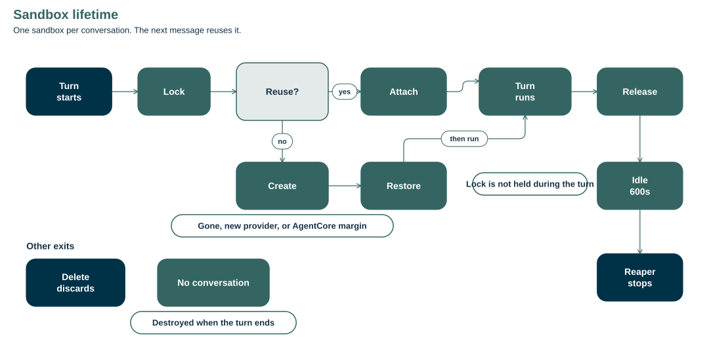
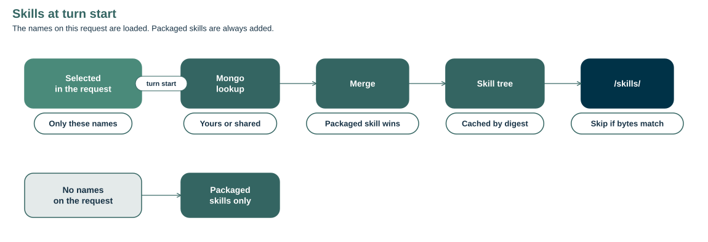
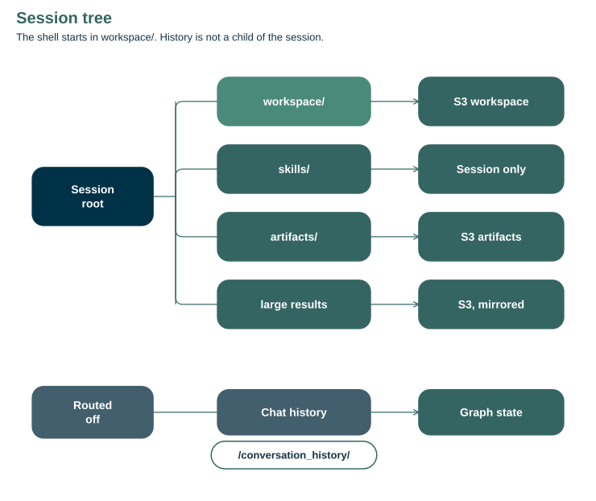

## Sandbox

A conversation keeps one sandbox. A message does not create a new one and does not destroy it. The next message reuses that sandbox and restarts the idle timer, so a file written in one turn is still there on the next turn. The sandbox goes away when it has been idle, when it is replaced, or when the conversation is deleted.

The provider session is `src/services/agents/core/sandbox.py`. The map shared by the workers is `src/services/agents/core/sandbox_pool.py`. `src/services/agents/core/runner.py` acquires the sandbox for a turn and releases it afterwards. Deleting a conversation calls `discard_conversation_sandbox`. A reaper starts with the server and stops on shutdown. Shutdown does not destroy sandboxes.

A sandbox starts only when the graph's `compile` function takes a `backend` argument. Today that is the deep agent (`"agent": "deep"` on [agentic generation](api/routers-message.md#agentic-generation)). `SANDBOX_PROVIDER` unset or `none` starts nothing. A turn with no conversation id still uses `open_sandbox` / `close_sandbox`, and that sandbox is destroyed at the end of the turn, including when the turn fails. A streaming turn always has a conversation id and uses the pool.

### Providers

Settings are read when a turn starts, not at import. Every name this service owns starts with `SANDBOX_`. A provider SDK that already has its own names keeps those names.

| Provider | What it is | Settings |
| --- | --- | --- |
| `agentcore` | Bedrock AgentCore code interpreter, through `langchain-agentcore-codeinterpreter` | `SANDBOX_AGENTCORE_REGION` (required). `SANDBOX_AGENTCORE_IDENTIFIER` (default `aws.codeinterpreter.v1`) |
| `opensandbox` | `opensandbox` `SandboxSync` plus `langchain-sandbox-opensandbox` | `SANDBOX_OPENSANDBOX_DOMAIN` (required). `SANDBOX_OPENSANDBOX_PROTOCOL` (`http` or `https`, default `http`). `SANDBOX_OPENSANDBOX_API_KEY` (optional). `SANDBOX_OPENSANDBOX_IMAGE` (default `python:3.12`) |

AgentCore `sessionTimeoutSeconds` is an absolute cap. Activity does not extend it, and the API cannot renew it. The cap is 28,800 seconds ([`StartCodeInterpreterSession`](https://docs.aws.amazon.com/bedrock-agentcore/latest/APIReference/API_StartCodeInterpreterSession.html)). `SANDBOX_MAX_LIFETIME_S` defaults to 3600 and is clamped to that cap. Status `READY` can be attached. The sandbox is gone when the status is `TERMINATED`, or when `get_session` raises `ResourceNotFoundException`, a `ValidationException` whose message says `is not active`, or a `ConflictException` whose message says `already terminated`. Any other `get_session` error, and any other status, fails the turn and leaves the record in place. A wrapper that did not create the session must not call `close()`: `close()` stops a session this process created. Attach stops the remote session through the client. The data-plane client read timeout is 300 seconds.

OpenSandbox `renew` sets the expiry to now plus the duration given. `destroy` kills the remote sandbox. `close` only drops the local HTTP client. A connect error whose `status_code` is 404 or 410 means the sandbox is gone. Anything else fails the turn and leaves the record.



### Idle timer and replacement

| Setting | Default | Meaning |
| --- | --- | --- |
| `SANDBOX_IDLE_TTL_S` | 600 | How long the sandbox stays after the last turn |
| `SANDBOX_MAX_LIFETIME_S` | 3600 | AgentCore hard cap. Not used for OpenSandbox |
| `SANDBOX_REAPER_INTERVAL_S` | 30 | How often a worker looks for idle sandboxes |
| `AGENTIC_TURN_DEADLINE` | 480 | Turn deadline. Added to the idle window while a turn is in flight |

While a turn is in flight the sandbox deadline is now plus `SANDBOX_IDLE_TTL_S` plus `AGENTIC_TURN_DEADLINE` (600 + 480 = 1080s). OpenSandbox's expiry is renewed to that same window. When the turn ends, the deadline goes back to now plus the idle window. The idle window stays in the in-turn sum so a turn that dies before release still leaves the sandbox up. An earlier release of a concurrent turn does not pull the deadline in. The count of those turns is `inflight`.

```text
10:00  turn starts, sandbox created, deadline 10:18
10:02  turn ends, deadline 10:12
10:05  next turn reuses it, deadline 10:23
10:06  turn ends, deadline 10:16
10:16  the reaper stops it
```

AgentCore also ends the session at `SANDBOX_MAX_LIFETIME_S` (3600s) after creation, and nothing extends that. A session is reused only while more than `AGENTIC_TURN_DEADLINE` plus 60s remain (540s). A session with 200s left is replaced, because the turn may run 480s.

A record is replaced only when the provider reports the sandbox gone, when the provider changed, or when an AgentCore session is inside the hard-cap margin and `inflight` is 0. A throttle, a timeout, or any other attach error keeps the record and fails the turn. A failed stop also keeps the record, so the reaper can try again. A failed save of a new sandbox destroys that new session. If the lock is lost after the new session was created, that session is destroyed and not saved.

A deadline that is already past, or missing, clears a stale `inflight` before the reuse decision. Otherwise a crashed turn would keep a session that is about to hit the AgentCore cap.

OpenSandbox records do not store `created_at` or `max_lifetime_s`. They stay reusable. Their expiry moves with `renew`.

### Redis

The map is in Redis when `REDIS_URL` is set, because the next message can land on another gunicorn worker. Without Redis the map is in this process only. Tests install a fresh in-process map so a `REDIS_URL` in CI cannot leak records between tests.

| Key | Type | Contents |
| --- | --- | --- |
| `sandbox:conv:{conversation_id}` | hash | `provider`, `sandbox_id`, `skills_digest`, `inflight`, `user_id`, `process_baseline`. AgentCore also stores `region`, `identifier`, `created_at`, `max_lifetime_s` |
| `sandbox:idle` | zset | Member is the conversation id. Score is the kill deadline as epoch seconds |
| `sandbox:lock:{conversation_id}` | string | `SET NX PX` for 180 seconds |

The lock covers create, attach, release, discard, and the reaper. It is not held while the turn runs, so two turns of one conversation share the sandbox. A waiter polls until the holder releases. There is no fixed wait. A dead holder stops refreshing and the key expires within 180 seconds. The reaper tries once and skips a lock that is held. The holder refreshes every 60 seconds. A Redis error on that refresh is retried. The lock is lost only when the refresh sees another token. Before every other write the holder asks Redis again and extends the key, so a write does not run on a lock that has already expired. The in-flight count and the deadline move in one script that also checks the token. A count that moved without its lease would never be released.

The reaper reads the deadline again under the lock. A turn that reattached between the scan and the lock is left alone.

### Skills and the graph backend



The names on the request are resolved before the sandbox is acquired. An empty list loads the packaged skills only. A packaged skill of the same name replaces the one from the database.

The skills digest is the sha256 of the uploaded `(path, bytes)` list, in upload order. The same digest skips the upload. A changed digest runs `rm -rf /skills` and uploads again. AgentCore stores `/skills/...` under the session working directory, because the process cannot create a real `/skills`. The shell rewrite points `/skills` at `{cwd}/skills`.

The backend passed to `compile` is a `CompositeBackend` whose default is the sandbox. `/conversation_history/` stays on `StateBackend`. It is not the memory of the chat: the model searches stored messages with `search_history` and `read_history`, under the summarization limits in [Tools and limits](context-management.md#tools-and-limits). `/large_tool_results/` is an S3 route when the turn has a conversation, and a copy is mirrored into the sandbox. With no conversation that prefix stays on the sandbox. `/skills/` is not routed: the file tools and the shell both read the tree that was uploaded into the sandbox.

### Workspace



The session root has four sibling directories: `workspace/`, `skills/`, `artifacts/`, and `large_tool_results/`. The shell starts in `workspace/`. A file the model creates belongs there. `skills/`, `artifacts/`, and `large_tool_results/` stay beside it.

An MCP file is stored once, at `users/{user_id}/conversations/{conversation_id}/artifacts/{artifact_id}/{filename}`. `Artifact.key` is that object. The sandbox path is `/artifacts/{artifact_id}/{filename}`. The chat still loads `/artifacts/{artifact_id}`. A file the user attaches ends up in the same folder; see [Attached files](#attached-files).

After a turn, `workspace/` is copied to `users/{user_id}/conversations/{conversation_id}/workspace/`. A new sandbox loads that prefix back into `workspace/`. A reused sandbox is not reloaded. A markdown path in `workspace/` is rewritten to `/conversations/{id}/workspace/{path}`. That route serves the saved workspace object. It is not copied into the artifact store.

The copy waits until no process is running beyond the set recorded at sandbox start, and two listings match on path, size, and mtime. The answer does not wait. The idle deadline moves forward while that save is still running, up to the AgentCore reuse margin. Before a sandbox is destroyed, one snapshot is saved without waiting. A sidecar object `workspace_state` stores size, mtime, and sha256 so an unchanged file is not downloaded again.

### Attached files

A file the user attaches in the chat lives in the conversation's `artifacts/` folder, like an MCP file, so the agent can open it.

`POST /artifacts` takes an optional `conversation_id` form field. With it, the backend checks that the user owns the conversation and writes the object once, at `users/{user_id}/conversations/{conversation_id}/artifacts/{artifact_id}/{filename}`. Another user's conversation, or a missing one, answers 404, stores nothing, and spends no upload quota. The composer sends the field whenever the chat already has an id.

A new chat has no conversation when the file is picked. Its upload waits at `users/{user_id}/artifacts/{uuid}.{ext}`. When the message that carries it in `artifact_ids` arrives, `resolve_artifact_attachments` binds the artifact to the conversation and `move_to_conversation` moves the object: copy inside the bucket, update `Artifact.key`, delete the old object. A failed copy keeps the old key and logs `artifact.move_failed`. The attachment still renders, but the sandbox does not get the file. A failed delete leaves a stray object and logs `artifact.move_cleanup_failed`.

Before the graph runs, `_attached_files` in `runner.py` reads the message's attachments that are in the conversation folder:

| Sandbox | What happens |
| --- | --- |
| Started by this turn (`SandboxLease.fresh`) | `restore_artifacts` already copied the folder in. Nothing more is copied |
| Reused from an earlier turn | `copy_into_sandbox` copies this message's files in. A file that cannot be read logs `artifacts.attach_read_failed` and is skipped |
| None (graph without a sandbox, or no conversation) | No paths |

The paths follow the query in the human message of that turn:

```text
{user message}

## Attached files
The user attached the following files:
/artifacts/{artifact_id}/{filename}
/artifacts/{artifact_id}/{filename}
```

The block is in the thread, next to the turn it came with. `Message.input` and the chat keep the text the user typed. A file outside the conversation folder is left out of the block, because its path would name nothing. A lookup that fails logs `Could not attach files` and runs the turn without the block. Filenames are cleaned at upload (one line, no control or format characters, capped), so a name cannot add lines to the block.

### Checking it

Use `"agent": "deep"`. Ask the model to write a file, then in a later message of the same conversation ask it to read that file. The backend log shows `sandbox.created` and then `sandbox.reused` with the same `sandbox_id`. Reading the file from the sandbox itself confirms the text. The model can also repeat a marker that was already in the first message. Discard the sandbox when the check is done.

For attached files, attach an image in a new chat and ask the model which files it got. It names `/artifacts/{artifact_id}/{filename}` and can open it. In the same chat, attach a second file and ask again: the log shows `sandbox.reused`, and the model opens the new file too. The object is under `users/{user_id}/conversations/{conversation_id}/artifacts/` in the bucket.

Values already in the process environment are kept when `LOAD_DOTENV_OVERRIDE=false`. Otherwise a value in `.env` replaces them, including AWS credentials the provider SDK would otherwise take from the SSO chain.
